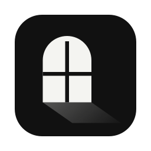
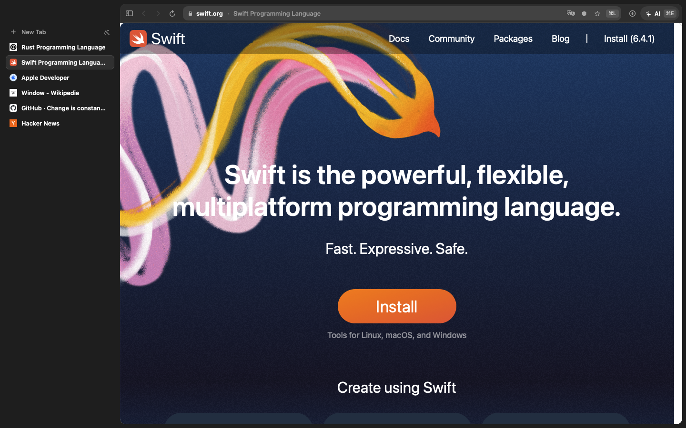

<p align="center"></p>

<h1 align="center">Changmun</h1>

<p align="center">
  <b>A light Mac browser with a sidebar and an AI that can use it.</b><br>
  Safari's WebKit engine, vertical tabs, favorites and bookmark folders on the left, and a Claude panel that reads pages, clicks and types for you.
</p>

<p align="center">
  
  <a href="LICENSE"></a>
  
</p>

<p align="center">
  <b>English</b> · <a href="README.ko.md">한국어</a> · <a href="README.ja.md">日本語</a> · <a href="README.zh-Hans.md">简体中文</a> · <a href="README.es.md">Español</a> · <a href="README.de.md">Deutsch</a> · <a href="README.fr.md">Français</a>
</p>

<p align="center">
  
</p>

*Changmun* (창문) is Korean for *window*, which is about as honest as a browser name gets. It's free, open source, and has no account or tracking. The app speaks English, Korean, Japanese, Simplified Chinese, Spanish, German and French.

## Why Changmun

- **Light.** Chromium browsers each bundle their own copy of Chromium. Changmun borrows the WebKit engine already on your Mac, the one Safari uses, so the download is about 3 MB (the 0.4.1 DMG is 2.6 MB). It's easy on the battery, and engine security fixes arrive with macOS and Safari updates.
- **A sidebar like Arc and Dia.** Vertical tabs, which give titles room to breathe, plus favorites as tiles, bookmark folders, tab groups and spaces.
- **An AI that uses the browser.** The Claude panel reads pages and clicks and types for you through your existing `claude` CLI. It gets hands, not a free pass: it asks before anything risky.
- **Private by default.** No account, server or analytics, so there's nothing to sign up for. Ad and tracker blocking is built in.
- **Comes with your stuff.** Imports bookmarks and history from Safari and Chromium browsers, plus passwords and sign-ins from the Chromium ones. Moving in, furniture included, except Safari's passwords, which macOS won't hand over.

## Install

```sh
brew install --cask namekun/tap/changmun
```

Needs [Homebrew](https://brew.sh), macOS 14 Sonoma or later and an Apple silicon Mac. The app is signed with a Developer ID and notarized by Apple, so it opens right away. To update, run `brew update && brew upgrade --cask changmun`.

On first launch Changmun offers to bring over bookmarks and history from the browser you use now, plus passwords and sign-ins if it's a Chromium browser.

### Build from source

You need macOS 14 or later and Xcode or the Command Line Tools.

```sh
git clone https://github.com/namekun/Changmun.git
cd Changmun
scripts/bundle.sh release   # makes build/Changmun.app
open build/Changmun.app
```

With only the Command Line Tools installed, the scripts build against the macOS 26 SDK (the macOS 27 SDK's SwiftUI macro plugin ships only with Xcode). Build products go to `~/Library/Caches/Changmun/build`, out of reach of iCloud Desktop syncing.

## What it does

### Sidebar and tabs

- **Sidebar.** Favorites, bookmarks and open tabs share one column on the left: favorites as tiles, bookmark folders, vertical tabs. Drag tabs to reorder them, or onto the favorites to pin them. Favorites and bookmarks each keep their own tab, like Dia and Arc: clicking one goes to its tab instead of replacing the one you're reading (⌘-click opens a new tab). Drag a link from a page onto the sidebar to open it as a tab, make it a favorite or file it in a folder. A tab's menu also reloads, duplicates, moves it to a new window, shares it or opens it in another browser. Closing a group's tabs or removing a bookmark can be undone for a few seconds, which is usually when the regret arrives.
- **Address bar where you like.** Put it where your hands expect it: at the top of the sidebar below back and forward, as in Arc, or above the page, as in Dia (Settings › Appearance › Address Bar Position). It shows just the site; the shield comes up when the pointer is over it, and so does the star, which stays for a favorite: click it to take the page out of the favorites.
- **Bookmark folders.** Your bookmarks keep the filing system you built, and stay within reach. Imported folders keep their nesting, as in the browser they came from. Pin the ones you use to the sidebar (right-click or … › Pin to Sidebar, or drag the folder up under the favorites) and open them right there. Drag a bookmark onto another folder or onto the favorites, or use Move To in its menu. The rest of your bookmarks are behind the bookmark button at the bottom of the sidebar, with a search field; the … beside it opens History, Archived Tabs, Focus Mode and Settings.
- **Tab groups.** Related tabs stay together and out of the way. Right-click a tab › Add to New Group, name it, fold it. Tabs opened from a group's tab join the group; a reopened tab (⌘⇧T) finds its way back to its group. Drag a group by its header to move it, or up onto the favorites or the pinned folders to keep it, tabs and all, as one bookmark folder.
- **Tidy tabs.** Turns a pile of loose tabs into groups in one click. Wave the wand next to "New Tab" (Window › Tidy Tabs) and the loose tabs get grouped. With Apple Intelligence on (macOS 26), the model on your Mac groups them by topic and names the groups; nothing about your tabs leaves the Mac. Without it, tabs opened from one another and tabs of one site go together. "Undo" puts things back for a few seconds. New tabs you open from the address bar join a matching group on their own (turn it off in Settings › Tabs).
- **Archive old tabs** (off by default). Tabs you've stopped using get put away, not thrown away. Tabs you haven't looked at for a set time (12 hours to 30 days, counted only while Changmun runs) close into History › Archived Tabs, ready to reopen into their group. Visible, playing, picture-in-picture, camera/mic, favorite and private tabs are never archived.
- **Sleeping tabs.** Lets background tabs nap and hands their memory back. Background tabs you haven't seen in 20 minutes, and all background tabs under memory pressure, give back their web process and come back with their history when you return.
- **Command bar** (⌘T). One box, many errands: search, addresses, switching to open tabs, bookmarks and history, and asking the AI.

### Spaces and profiles

- **Spaces.** Separate sets of tabs, tab groups and favorites for different kinds of browsing, so work stays out of your weekend. The row at the bottom of the sidebar switches between spaces: click a dot, press ⌃1–⌃9, or swipe sideways with two fingers over the sidebar (Window › Next Space, Previous Space, New Space…). Each space has its own tabs, tab groups, favorites and pinned folders, and tints the sidebar with its colour. The bookmark library, history and saved passwords are shared. Turn on "Keep logins and cookies separate (profile)" when you make a space to give it its own cookies and site data too, so one site can have two accounts signed in side by side; that can't be changed afterwards, and deleting a profile erases its cookies and site data. Your first space is made from what you already had. Private windows have no spaces. The AI sees the tabs of ordinary spaces (with the space's name), but those of a profile space only while you're in it.

### Reading and watching

- **Reader mode.** Strips an article down to clean, readable text. ⇧⌘R (or ⌥⌘R with Chrome-style shortcuts) shows it over the page. A button appears in the address bar when the page looks like an article. Esc, the ×, or the same key brings the page back as it was. A small script on the page does it: the article's images load from the same places the page loads them from, and nothing else is downloaded or sent.
- **Translate pages.** Read a page in another language without leaving it. It's translated in place with macOS's on-device translation (⌥⌘T, macOS 26+). Links and layout stay; the text never leaves the Mac.
- **Split view** (⌥⌘\\). Two tabs side by side, for the times one page isn't enough.
- **Focus mode** (⌘⇧F). Hides everything but the page. Staying focused on it is up to you.
- **Link preview.** Peek at a link without leaving the page you're on. ⇧-click a link to open it in a floating card, ⌘↩ to keep it as a tab.
- **Picture in picture** (⌃⌘P). Keeps a video in view after you leave its tab. It turns on by itself when you leave a tab with a playing video. ⌃⌘← / ⌃⌘→ skip 5 seconds even while you're in another app, and "Back to tab" brings the tab forward.

### Privacy and safety

- **Private windows.** Browse without leaving anything behind. Private windows keep their cookies and site data in memory and forget them when closed; nothing goes to history, the session or the AI.
- **Site settings.** What Changmun remembers about a site, shown and changed in one place. Click the lock icon at the left of the address bar for a small panel with what Changmun keeps for that site: ad blocking, zoom, pop-ups, camera and microphone, and whether its tabs may sleep. Click anywhere else on the address bar, the site name included, to edit the address, as before.
- **Passwords.** Remembering them is the Keychain's job. Passwords are saved to the Keychain after you sign in (https only) and filled from the key in the address bar. Copying one asks for Touch ID or your Mac password.
- **Pop-ups.** Pages don't get to open windows on you unasked. Pop-ups opened without a click are blocked, with "Open" and "Always Allow for This Site" right above the page.

Ad and tracker blocking is covered under [Ad blocking](#ad-blocking), and what stays on your Mac and what is sent is covered under [Privacy](#privacy).

### Saving and downloads

- **Save a page.** Keep a page for later as a PDF or a picture. Save it as one long PDF (File › Save as PDF…) or as a picture of the whole page, not just what's on screen (File › Capture Full Page…). Both are also in a tab's menu, save to your Downloads folder unless you pick another, and work in private windows too. Pages that scroll inside an inner panel and images that load only on scroll may not be captured in full.
- **Downloads.** See how a download is going, with a safety check on first open. Downloads show their progress at the bottom of the sidebar and get Safari's quarantine flag, so Gatekeeper checks them on first open. Apps, scripts and installers are shown in Finder instead of run. A download that breaks off picks up from where it stopped with Try Again on its row.
- **Page zoom.** Zoom a site once and it stays zoomed: page zoom is remembered per site, so you only squint once.
- **Session saving.** Browsers crash. Open tabs are saved every 15 seconds, so a crash costs almost nothing.

### Updates

- **Update notice.** Tells you when a new version is out. Changmun is updated through Homebrew. Once a day it asks GitHub for the latest release, and when there's a newer one a quiet note at the bottom of the sidebar copies `brew upgrade --cask changmun` for you. Turn it off in Settings › Advanced › Check for Updates.

## AI

The panel on the right (⌘E) uses the `claude` CLI you already have, so it runs on your Claude Code subscription. The default model is Sonnet; switch with `defaults write io.github.namekun.Changmun aiModel opus`.

The AI gets these tools: `list_tabs`, `open_tab`, `switch_tab`, `close_tab`, `navigate`, `go_back`, `go_forward`, `reload`, `read_page`, `read_tabs`, `click`, `click_at`, `type_text`, `press_key`, `select_option`, `hover`, `drag`, `wait_for`, `scroll`, `screenshot`. Passwords, one-time codes and card fields are off limits: it can't read their values (also after a "show password" button turned one into plain text), type or press keys in them, and screenshots mask them. It can't upload files either.

- `read_page` numbers the buttons, links and fields, and the other tools take those numbers. It reads frames too: those of the same site fully, those of other sites when WebKit lets Changmun reach them (the page says when it can't). Elements inside shadow DOM (web components) aren't listed; `click_at` reaches those.
- `click_at` clicks a point of the visible page, for what `read_page` can't list (a canvas, a map). The point is in CSS pixels from the page's top left, which is what a `screenshot` shows: the picture is as wide as the page is in CSS pixels (up to 1280, a wider page is scaled down and the picture's note says by how much), whatever the page zoom or the screen's pixel density. It says which element was hit.
- `press_key` presses Enter, Escape, Tab, Backspace, Delete, Space, an arrow, Home, End, PageUp or PageDown, optionally with shift, alt, ctrl or meta. No letters or symbols, so it can't type text. The page gets keydown, keypress and keyup; what the page leaves alone is done as the browser would (Enter activates a button or submits a form, Tab moves focus, Escape closes a dialog, arrows move the cursor, change a list or scroll, Backspace and Delete edit a text field). Those defaults are emulated, because script-made key events don't trigger them, and combinations with alt, ctrl or meta only reach the page's own handlers.
- `select_option` picks an option of a list by its text or value, also in custom listboxes and comboboxes. It finds the option first, judges the one it found (not the words it was asked with), and picks it only if it's still the same. `hover` moves the pointer over an element (the pointer and mouse enter, over and move events) so script-driven menus open; a menu made only with the CSS `:hover` rule doesn't. `drag` drags between two elements or points, as HTML5 drag and drop when the source is draggable and as pointer and mouse events otherwise. `wait_for` waits for text to appear or go away, or for the page to finish loading, for up to 30 seconds (10 by default); a look at the page that gets no answer doesn't count as "gone".

While it works, its target is outlined on the page with a small "AI" label that goes away by itself (without motion when "Reduce motion" is on), and the panel says what it's up to ("Clicking “Sign in”", "Waiting for “Results”"). If the page changes between the AI's look and its action, even while you're deciding, the action is dropped. Stop ends a wait at once, takes the outline off and withdraws a question you haven't answered, so a late "Allow" can't run anything. Tabs the AI is using aren't put to sleep or archived while its run lasts (for other agents, for 90 seconds after each use), and the three used last stay in the window behind the page you're looking at, invisible, so their timers go on.

To work across several tabs, add them under the chat with "Add Tab" (one by one, a tab group, or all open tabs): they show as chips you can remove, the AI reads them together with `read_tabs`, and you aren't asked before it reads them. With two or more attached, the panel suggests comparing them or boiling each down to its key points.

A web page can hide instructions meant for an AI. So that such instructions can't make it carry what it read somewhere else, Changmun asks you first. No answer after 90 seconds counts as no:

- before it uses a tab you aren't looking at, once per tab and site;
- before it opens an address, unless it's a search, an address already open, visited or bookmarked, or a known site's front page;
- before every click, key press, hover, drag, typed text or chosen option once the chat has read another site (what a frame of another site showed counts as read from that site, and a frame with no site of its own is a site of its own), showing what it's about to do. You can allow it once, or allow it on that site until the chat is cleared, which keeps it to about one question per site. Reading yet another site takes that allowance back, and a new chat (⌘⇧E) starts over. Only scrolling goes without asking: it moves what's in view and can neither press nor carry anything.

The site is the one the page itself says it is, from inside the frame, at the moment of the action, so a frame that moves to another site after the AI looked is asked about as that other site.

Whatever you've allowed, and even with the setting off, it asks every time before something that looks like it pays, orders, books, sends, posts, shares, saves, deletes, transfers or confirms: a click, a click at a point, Enter or Space on it, Enter in a form's field, a chosen option, dropping something on it (or dragging it) or Enter after typing into a message box. It judges by every name the control has (what it says, its accessible name, a picture's alt text, its title, and the markup of an icon with no words) in English, Korean, Japanese, Chinese, Spanish, German and French, and by a submit button in a form that asks for card details or posts to a checkout. It shows the button's text and the site. This is a guess, made to err on the side of asking: a page can name a button anything, so a button that looks harmless isn't proof, and one that merely contains a word like "post" is asked about too.

Other agents, like Claude Code, can use the same tools through MCP, with the same questions:

```sh
claude mcp add changmun -- /Applications/Changmun.app/Contents/MacOS/Changmun --mcp
```

`--mcp` starts Changmun if it isn't running. The control server listens only on 127.0.0.1 and needs a token that changes every launch.

Or from a shell, for any agent that can run commands (Homebrew puts `changmun` on the PATH):

```sh
changmun tabs
changmun open example.com
changmun read
changmun read-tabs 3 5
changmun click 12
changmun type 3 "hello" --submit
changmun press Enter
changmun wait "Results"
```

`changmun help` lists the rest. Each command is one of the same tools, with the same questions, and starts Changmun if needed.

## Shortcuts

Pick Safari-style or Chrome-style in Settings (⌘,). Only the keys the two browsers disagree on change.

| Keys | Action |
| --- | --- |
| ⌘T / ⌘L | Command bar / edit the current address |
| ⌘E / ⌘⇧E | AI panel / new AI chat |
| ⌘D | Add or remove a favorite |
| ⌘N / ⌘⇧N / ⌘⇧W | New window / new private window / close window |
| ⌘W, ⌘1–9, ⌘⇧[ ⌘⇧] | Close tab, go to a tab in sidebar order |
| ⌃Tab / ⌃⇧Tab | Switch tabs in the order you last saw them (hold ⌃, press Tab, let go; esc cancels) |
| ⌃1–9 | Go to a space (9 is the last); gives way to macOS's "Switch to Desktop N" if you've turned that on |
| ⌃⌥← / ⌃⌥→ | Previous / next space |
| ⌃⌘N | New space |
| ⌥⌘\\ | Split view on or off |
| ⇧-click | Link preview: esc closes, ⌘↩ opens it as a tab |
| ⌘⇧T | Reopen closed tab (or the closed window when no tab is left) |
| ⌃⌘M | Mute or unmute the tab |
| ⌃⌘P | Picture in picture on or off |
| ⌃⌘← / ⌃⌘→ | Video back or forward 5 seconds |
| ⌥⌘T | Translate the page / show the original |
| ⌘F, ⌘G, ⌘⇧G | Find on page, next, previous |
| ⌘Y | History |
| ⌘O, ⌘P, ⌘⇧C | Open file, print, copy the address |
| F12 or ⌥⌘I | Web Inspector |
| ⌘⇧F | Focus mode |

| Action | Safari-style | Chrome-style |
| --- | --- | --- |
| Sidebar | ⌘⇧L | ⌘S |
| Hard reload | ⌥⌘R | ⌘⇧R |
| Reader mode | ⇧⌘R | ⌥⌘R |
| Console | ⌥⌘C | ⌥⌘J |
| Downloads | ⌥⌘L | ⌘⇧J |
| Previous Tab / Next Tab | | ⌥⌘← ⌥⌘→ |

## Ad blocking

Changmun turns EasyList (ads) and EasyPrivacy (trackers) into WebKit content-blocking rules and refreshes them every 4 days. In Settings › Privacy you can turn lists off or add others by address (a Korean ad list is one click away). If a site breaks, the shield in the address bar turns blocking off for that site. Rules WebKit can't express (regular expressions, `$redirect`, scriptlets, `:has-text` and other extended selectors) are skipped rather than guessed: a missed ad beats a broken page.

## Extensions

Managed in Settings › Extensions (web extensions need macOS 15.4 or later).

In the tabs of a profile space, extensions run, but their cookie APIs see only the default data store, not the profile's.

- **Safari extensions from the App Store** show up once installed and ask for their permissions when you turn them on.
- **Chrome Web Store extensions**: open an extension's store page and "Add to Changmun" appears above it (or paste its address or ID in Settings). Changmun unpacks it into `~/Library/Application Support/Changmun/Extensions` and loads it as a WebKit extension; adding it again updates it.
- **Safari content blockers** (Unicorn, AdGuard and others): macOS only lets Safari ask a blocker for its rules, so Changmun reads the rule file the blocker saved. macOS asks once to let it read another app's data.
- An unpacked extension folder (with `manifest.json`) loads too. Some features, like talking to a native app, may not work.

## Importing from other browsers

On first launch, or from the menu, Changmun imports bookmarks and history from Safari and from Chromium browsers: Chrome, Arc (with its sidebar), Dia, Aside, Whale, Brave, Edge, Vivaldi. From Chromium browsers it also brings passwords and cookies, so you stay signed in.

- Passwords and cookies are decrypted with each browser's Keychain item (`<name> Safe Storage`), so macOS asks you to allow it. Imported passwords go to your login Keychain labeled `Changmun`.
- Reading Safari needs Full Disk Access. macOS doesn't hand Safari's passwords to other apps.

## Privacy

- Your browsing stays on your Mac. Changmun has no account, server or analytics.
- The update check asks GitHub's public releases API for the latest version number once a day and sends nothing else (Settings › Advanced turns it off).
- Search suggestions send what you type in the command bar to your search engine (turn them off in Settings; never sent from private windows).
- The AI panel sends your messages, and the page content the AI reads, to Anthropic through the `claude` CLI. Tidy tabs and page translation run on your Mac.

## For developers

```sh
scripts/test.sh            # unit tests (Swift Testing)
scripts/check-strings.sh   # every string the code uses is translated in every language
swift scripts/make-icon.swift
scripts/release.sh 0.2.0 notes.md   # checks, DMG, GitHub release, Homebrew tap
```

UI text is English in the code and translated in `Resources/<language>.lproj/Localizable.strings`; add every new string to all six tables.

`scripts/headless.sh` runs a headless Changmun for tests and agents: off screen, never takes focus or plays sound, with its own profile in `~/Library/Application Support/Changmun Headless`. It doesn't touch the Keychain, and answers AI confirmations, site permissions and JavaScript dialogs by itself (permissions are denied).

```sh
scripts/headless.sh start                                   # copy build/Changmun.app as the headless app and start it
scripts/headless.sh call open_tab '{"url": "example.com"}'  # the AI's tools: list_tabs, navigate, read_page, click…
scripts/headless.sh shot window.png                         # the whole window, sidebar included
scripts/headless.sh stop
```

## License

[MIT](LICENSE)
